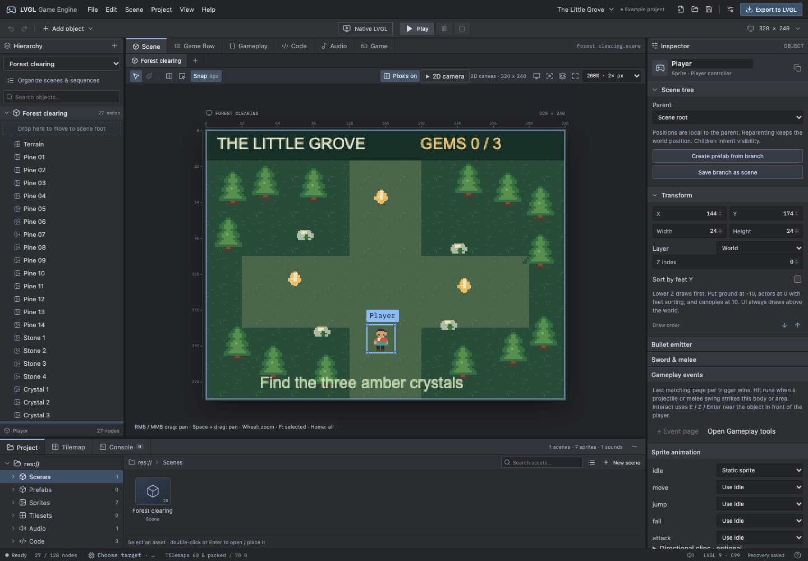

# LVGL Game Engine 2D — Desktop

**License:** [Custom noncommercial source-available license](LICENSE.md).
Commercial use is prohibited. Engine distributions and hosted forks must provide
corresponding source; forks must retain persistent visible attribution. This is
not an OSI-approved open-source project. Third-party components retain their own
licenses. See [public edition scope](docs/PublicEdition.md).

A standalone visual game editor for **macOS Apple Silicon**, with a portable C99 runtime for **LVGL 9.4–9.6**. Build scenes and UI, paint tilemaps, attach behaviors and sounds, write C game logic, and export a clean firmware `ui/` folder.




## Launch the app

Build the standalone app with `npm ci` followed by `npm run desktop:build`, then open `release/mac-arm64/LVGL Game Engine 2D.app`. Build outputs are not included in this source repository.

**The built app does not require a browser, Node.js, npm, an Internet connection, or a dev server.** The UI, fonts and runtime templates are bundled in the application. This is a local build; public distribution signing/notarization has not been configured.

## CLI and AI agents

Use `./bin/lge commands` for machine-readable command discovery, or the standalone `LVGL Game Engine.app/Contents/MacOS/lge` launcher bundled with the macOS app. Agents can inspect/edit scenes and resources, import/paint tiles, manage C hooks, validate, export, run the actual C with native LVGL and PNG captures, and build STM32H7S78-DK artifacts. Live edits use the editor's Undo history; closed-project changes use atomic saves, revision checks and backups. See the [CLI and agent guide](docs/CLI.md) for commands, schemas, examples and exit codes.

## Editor workbench

The desktop layout uses compact menus and play controls, a left Hierarchy, a central Scene/Game viewport, a full-height Inspector and a bottom Project/Console dock. Drag dividers to resize panels; double-click a divider to reset it. View → Reset editor layout restores defaults. Layout changes do not edit your project.

Project contains Scenes, Prefabs, Sprites, Tilesets, Audio and Code folders. Single-click selects an asset; double-click or Enter opens it, places a sprite or auditions audio. Selection also exposes explicit Open / Add to scene / Instance / Audition actions. Search and list/thumbnail views are available. Inspector sections fold. Scene document tabs switch between authored scenes. Game starts the fast preview; Native LVGL still compiles and runs the actual C.

Scene navigation: right/middle-drag or Space+drag pans, the wheel zooms around the pointer, F frames the selection and Home frames the whole scene. Manual zoom survives panel resizing and Play/Stop. [Scene navigation guide](docs/SceneNavigation.md).

See [Workbench guide](docs/Workbench.md) for keyboard resizing, focus mode and workflow details.

## Hierarchy and prefabs

Drag objects onto rows to parent them, between rows to reorder them, or onto the scene-root drop target to detach them. World positions stay fixed; Undo restores the entire move. Linked children are edited through their source.

Choose **Inspector → Create prefab from branch** for reusable objects. **Project → Prefabs** offers **Edit prefab**, **Place instance** and **Create spawn pool**. Pools reserve bounded copies up front; **Play → Prefabs** tests spawn/despawn without changing the project. Firmware uses `ui_prefab_spawn`, `ui_prefab_node` and `ui_prefab_despawn`, with generation-checked handles and no per-spawn object allocation. [Prefab workflow and API](docs/Prefabs.md).

## 2D gameplay tools

**Gameplay** adds organized event scripts, state/quest flags and inventory stacks, branching paginated dialogue/choices, waits, room warps with spawn positions, and reusable recipes for conversations, chests, doors, patrols and small turn encounters. Object state remaps let linked copies share behavior while owning independent saved progress. Play includes a live state/checkpoint monitor; exported C exposes matching state, object-remap, dialogue and checksummed save-buffer APIs.

2D controllers now include tile-step RPG movement, one-way platforms and optional jump buffering/coyote grace. Sprites support motion/four-direction clips; Z/foot sorting handles top-down occlusion. Projects can organize 256 rooms, 512 sprites and 512 state fields while retaining the 128-node active-scene limit.

**Project settings → Touchscreen controls** enables an editable D-pad/Action/Talk overlay for the current scene. Hold or slide between arrows to move; release to stop. It is enabled in the STM32H7S78-DK demo and uses the board's existing LVGL touch driver. [Touch controls](docs/TouchControls.md).

Open **Help → Open 2D Gameplay Lab** for an original two-room quest/encounter with two linked chests and independent saved flags. See [2D gameplay guide](docs/Gameplay2D.md) for authoring, API, budgets and an explicit comparison with the requested retro game styles, including mechanics that still require custom code or additional engine work.

## Pixel art rendering

**Pixels on** in the viewport enables whole physical-pixel zoom in Scene, Game and Native LVGL, with display-pixel alignment and scrolling instead of downsampling. The setting is also in Project settings and is saved with the project. Inspector → Sprite pixel scale offers native size and whole enlargements; custom sizes that unevenly resample source art produce warnings. Physics retains subpixel precision and only final world drawing snaps. Exports bake nearest-neighbor image variants to avoid runtime transform artifacts. Software ports use compact palettes; NeoChrom uses aligned ARGB8888 textures for compatible GPU and software-fallback rendering. See [Pixel Perfect](docs/PixelPerfect.md) for Retina scaling, MCU costs and the firmware contract.

## Target guidance

**Project → Target guidance…** offers 60 MCU reference profiles from 13 vendors, plus custom budgets, Embedded Linux and Host PC. It estimates RAM, code/graphics/WAV storage, display traffic and rendering/physics workload; suggests external RAM, SD/flash or suitable DMA2D/GPU/Helium integrations; and keeps MCU warnings quiet for Linux/PC. Adjust actual memory, buffer plans, throughput and firmware reserves. Advice never configures a board or blocks export. The chosen assumptions save with the project; every export includes `target-guidance.json` with the current advisory snapshot and exact payload counts.

See [Target guidance](docs/TargetGuidance.md) for the workflow and estimation limits, and the [sourced MCU catalog](docs/TargetCatalog.md) for reference parts, capacities and capabilities.

## Tilesets and placement

**Project → Import tileset…** slices PNG/WebP/JPEG sheets with configurable size, margins and spacing, atlas selection, transparent-cell skipping and optional duplicate merging. The Tilemap dock offers multi-tile stamps, Brush, Eraser, Rectangle, Flood fill, Pick and shared solid-tile properties, with one undo step per gesture. Imported tiles are organized as reusable Tilesets resources.

Exports preserve stable byte indices for up to 255 tile types, omit unpainted graphics, deduplicate identical image payloads, choose RLE16/RAW8 by size, and use at most 32 bytes of collision flags. Each tilemap remains one LVGL object. `ui_tile_at` and `ui_tile_is_solid` provide read-only C queries; `tile-manifest.json` explains the bank values.

Try **Help → Open Tileset Workshop** or import [WorkshopTilesheet.png](examples/WorkshopTilesheet.png) with 16px tiles, 1px margins and 1px spacing. See the [Tileset guide](docs/Tilesets.md) and [example project](examples/TilesetWorkshop.lge.json).

## Playable 2D examples

## Physics and hitboxes

**Help → Open Physics Playground** opens a playable example with platforms, a custom character collider, child hurtbox, hazard hitbox and checkpoint trigger. Inspector → Physics separates artwork bounds from collision bounds, with canvas handles, Static/Character/Area roles, named layers and masks, top-down/platformer/code movement, gravity and grounded jumping. Add child Hitbox/Hurtbox/Trigger presets and link area-entry sounds. Show collision outlines in the Scene/Game viewport or native LVGL playtest.

## A straightforward workflow

Keyboard shortcuts: **⌘N** new, **⌘O** open, **⌘S** save, **⇧⌘S** save as, **⌘E** export, **⌘Z / ⇧⌘Z** undo/redo, **⌘1 / ⌘2 / ⌘3** Design/Code/Audio and **⌘4** Game flow. Native menus expose the same actions.

See [Scene organization](docs/SceneOrganization.md) for scene ownership, reusable sequences, session state and transition rules. Open [SceneComposition.lge.json](examples/SceneComposition.lge.json) for linked characters, crystals, HUD and menu buttons. Open [SceneJourney.lge.json](examples/SceneJourney.lge.json) for a complete Title → Level → Results example.

See [Native playtesting](docs/NativePlaytest.md) for the local compiler setup and controls, and [Code review](docs/CodeReview.md) for the architecture review and resulting refactors.

## Clean firmware export

```text
firmware-project/
└── ui/
    ├── ui.h, ui.c            public entry point
    ├── ui_ids.h              stable scene/node/sound constants
    ├── CMakeLists.txt
    ├── generated/            immutable scene data and packed images
    ├── engine/               portable game runtime and LVGL renderer
    ├── user/game_hooks.c     your game logic
    ├── assets/audio/         PCM WAV files
    ├── examples/             audio/board integration example
    ├── README.md             coding and integration guide
    ├── tile-manifest.json     map-bank IDs, names, solidity and usage
    ├── audio-manifest.json
    ├── target-guidance.json  advisory target budgets, sources and export snapshot
    ├── compression-report.json
    └── .lge-export.json      ownership metadata for safe re-export
```

Re-export preserves unrelated files. Hashes compare the editor's output, the last export and your current files. External edits are preserved if the editor has not changed the same file. Conflicting edits stop export and require a choice. Folders from other projects/tools are not overwritten. Publication stages a complete directory and restores the original if the final swap fails. ZIP exports carry the same ownership metadata.

The `.lge.json` project is the authoring source; it stays separate from the firmware UI directory. Old version 0.1 projects and `#include "game.h"` hooks remain compatible.

## A small C API

Initialize your LVGL display, tick and timer-handler loop, then:

```c
#include "ui/ui.h"

void start_game(void) {
    if (!ui_init()) { /* report initialization failure */ }
}

void poll_controls(uint8_t actions) {
    ui_set_input(actions); /* UI_INPUT_LEFT | UI_INPUT_UP, etc. */
}
```

```cmake
add_subdirectory(ui)
target_link_libraries(your_firmware PRIVATE lvgl_game_ui)
```

Use `ui_init_with_config()` to supply a parent screen, initial scene, audio backend and application state. Helpful calls include `ui_request_scene()`, `ui_find_node()`, `ui_label_set_text()`, `ui_node_set_position()`, `ui_node_set_visible()`, `ui_set_paused()` and `ui_audio_play()`.

`ui_request_scene(UI_SCENE_...)` is safe in an event/update callback: the runtime applies the transition at the next timer pass. START hooks run after their LVGL objects exist; EXIT runs before old nodes/widgets are released. Node/object pointers last until a scene changes; stable IDs are the lookup contract. Call `ui_deinit()` before destroying the parent or stopping LVGL.

Read [Coding API](docs/CodingAPI.md) for complete signatures, ownership rules and examples. A [sample project](examples/TheLittleGrove.lge.json) and [sample LVGL package](examples/TheLittleGrove.lvgl.zip) are included.

## Audio stays independent of hardware

Pass a complete `lge_audio_backend_t` through `ui_config_t.audio`, or NULL for silent operation. The backend implements **play / stop / pause / set_gain** as non-blocking commands to your audio worker. That worker handles URI/storage access, WAV decoding, mixing, looping, I²S/DAC/PWM and DMA. Completion tokens return to the LVGL thread through your worker queue and `ui_audio_complete()`.

The engine handles eight voices, bus/master gains, priorities, rejected requests, stealing, scene teardown and late completion tokens. All engine/LVGL calls belong to the LVGL owner thread. Hardware drivers and compressed audio decoding are board responsibilities; no physical board/speaker was tested here.

## Compression and embedded costs

- Sprites share asset/size variants and use I4/I8 palettes when smaller, with ARGB8888 fallback. Pre-sizing uses nearest-neighbor sampling.
- Tilemaps use RLE16 with RAW8 fallback when RLE would expand. They render through one LVGL draw-event object per layer; no widget per tile or full-map decompression buffer.
- ZIP uses DEFLATE for transfer; device flash savings come from packed image/map data. Audio remains PCM16 WAV.
- Core gameplay storage is bounded to 128 expanded nodes/scene, 16 tree levels and eight voices. LVGL still allocates widgets, draw tasks and image decode caches. Board RAM, frame rate and audio timing need target measurements.

The sample packs 19,200 used image bytes into 2,784 bytes and omits unused tile graphics, and its 70-byte RAW8 map into 60 bytes of RLE. Reports count payload bytes, excluding descriptors, runtime code, LVGL caches and display buffers.

## Session recovery

The app saves recovery snapshots and preferences in its normal Electron user-data directory under `~/Library/Application Support/LVGL Game Engine`. A recovery snapshot is separate from a saved project file. Native Save uses atomic replacement; Cancel keeps the current document. Unsaved changes trigger a Save/Discard/Cancel prompt before opening another project, creating a replacement or closing. Save a project file for backups and sharing.

## Build from source

Source work requires Node.js 22.12+ or 24+ and npm. These are development tools, not requirements for running the built application.

```sh
npm ci
npm run desktop:build
```

The macOS app is written to `release/mac-arm64/LVGL Game Engine.app`. `npm start` runs the bundled renderer from `dist/` in Electron; it also needs no server. `npm run desktop:dist` optionally builds a DMG. Windows/Linux targets are configured but have not been built or verified in this session.

For renderer-only development, `npm run dev` is available on port 5180; this is optional and is not the desktop launch path.

## Verify

```sh
npm run build
npm test
npm run test:files
npm run test:runtime
npm run test:playtest
npm run test:desktop
npm run test:ui
npm run test:lvgl
LGE_LVGL_VERSION=9.6.0 npm run test:lvgl
npm run desktop:build
npm run test:packaged
```

LVGL tests download a pinned upstream tag into ignored `.cache` folders. `LGE_LVGL_SOURCE` can point at an existing checkout. `npm run sample` regenerates example artifacts and the coding guide. Test evidence and practical limitations are recorded in [Verification](docs/Verification.md).

This remains an early game engine: no runtime scene spawning/additive loading, 2D transform rotation/scaling, animated sprite timeline, angular rigid-body physics or native C debugger is provided yet. The fast preview runs built-in behaviors; Native LVGL tests custom C locally. Verify board-specific code and timing with your firmware toolchain. Montserrat 14 is the current firmware font. Third-party notices are documented in [ThirdParty](docs/ThirdParty.md).

### 2D Toolkit Lab

Open **Help → Open 2D Toolkit Lab** for floor ramps, passenger-carrying platforms (including an exported C update-loop example), a bounded bullet-pattern arena and reusable RPG data. Gameplay now includes **Bullet patterns** with live previews and **RPG database** with linked items/skills/actors/encounters. The public API provides velocity queries, mutable controller speed, fixed-step time and safe platform displacement. See [the toolkit guide](docs/Toolkit2D.md). `npm run test:toolkit` runs the canonical exported game on real LVGL.

### RPG battles and animated terrain

Open **Help → Open RPG Battle Lab** for turn-based combat, party/inventory menus, status effects, XP/gold and rest events. **Gameplay → Party & battle** authors the roster and statuses; Battle script actions branch on outcomes. Party and inventory saves use the same validated TS/C format. See [RPG guide](docs/RPG.md).

The tilesheet importer supports multi-sheet queues, ACE/MV terrain and water layouts, neighbor-aware painting, custom animated tiles and nearest-pixel size reduction. See [animated tile guide](docs/AnimatedTiles.md). The supplied Country Woods / Modern+ packs generate the local **Country Crossing** example via `npm run example:country`; its project and LVGL ZIP are in `.local-examples/`. Paid artwork is not bundled into the editor.

The **STM32H7S78-DK Adventure** is available in Help. It targets the built-in 800 × 480 touch display with NeoChrom, a scrolling 3,072 × 2,048 overworld, directional sword animation, cuttable grass and animated water. [Board demo and firmware build](docs/STM32H7S78-DK.md) · [Editable project](examples/WillowlightH7.lge.json). The build script compiles separate Boot/Appli images against the pinned LVGL board port; device flashing and hardware timing are separate steps.

Use the toolbar’s **Build & flash** action to compile the current project, select an ST-LINK probe, program/verify/reset the H7S78-DK and monitor rendered FPS, render/flush time and GPU interrupts. [Editor board workflow](docs/BoardDeployment.md). The village demo now includes original detailed scenery and character art, animated shores/fountain and footprint-based depth sorting.

Firmware performance: [review, measured tradeoffs and portable fallback policy](docs/PerformanceReview.md). Re-export existing projects to receive the optimized runtime.

## Willowlight campaign

The private, pack-backed **Willowlight: The Names We Leave** campaign adds six chapters, optional town stories, action combat and saved progress. Rebuild it with `npm run example:willowlight`, using the supplied licensed packs in Downloads. Its first-play design target is 2–4 hours; human completion time has not been measured. See [the play/authoring guide](docs/WillowlightCampaign.md) and [Cutscene maker](docs/Cutscenes.md).

Running-device automation: [SWD game controls and frame capture](docs/SWDControl.md) provide optional ST-LINK input/camera commands and repeatable hardware benchmarks.

Physical controllers and sensor values: [Inputs & controllers](docs/PhysicalInputs.md) supports typed int32/float32/bool channels, ADC/GPIO, serial text and BLE report adapters. Configure calibration and bindings in Project → Inputs & controllers. [Physical Controllers example](examples/PhysicalControllers.lge.json) includes a joystick and temperature channel.

[Live input monitor](docs/LiveInputMonitor.md): connect serial/ADC bridges or BLE notifications, capture center/range, view bounded traces and test bindings against the compiled C runtime side by side in the editor.

[Hardware input wizard](docs/HardwareInputs.md): choose verified DK ADC/GPIO pins,
generate a joystick/button driver and wiring guide, then calibrate and test through
the live monitor. Controller updates preserve the bootloader and checkpoint schema.
